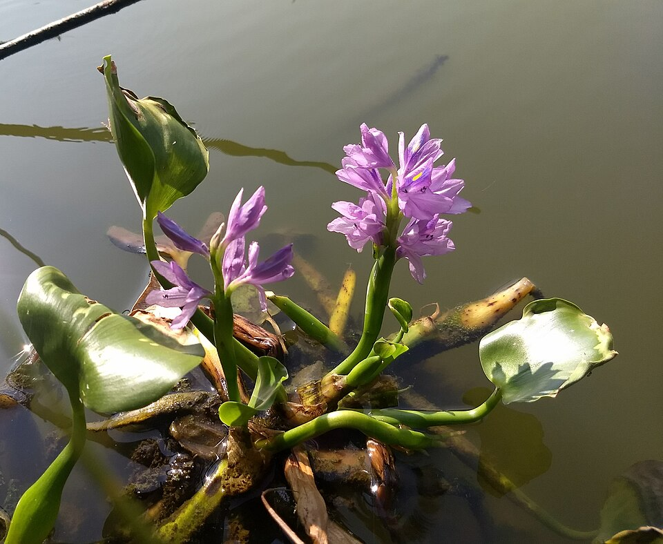
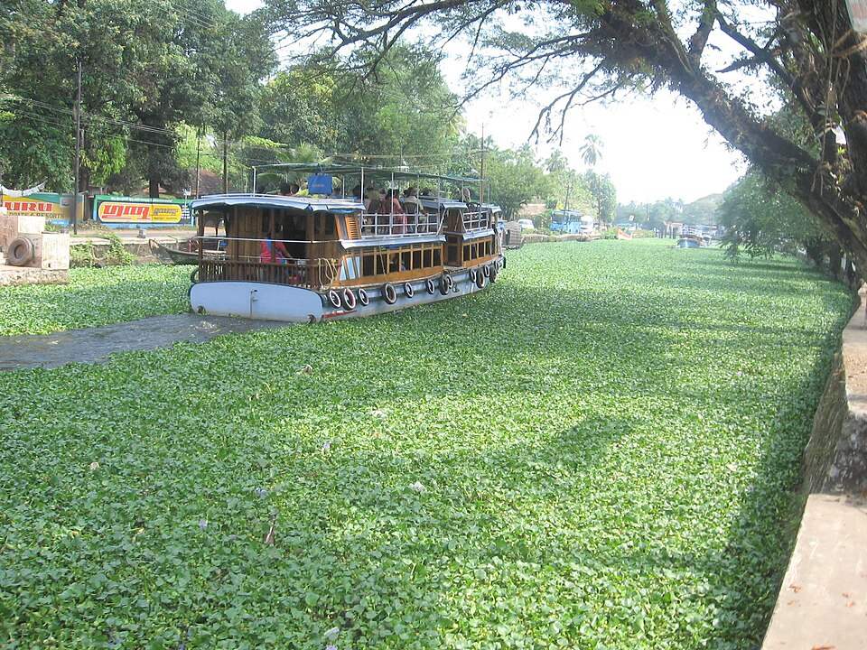
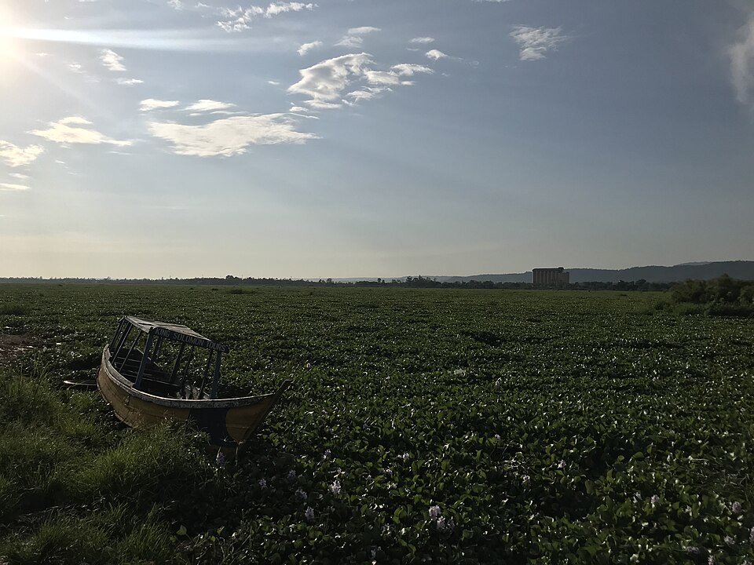

# Kulavazha Radar · കുളവാഴ റഡാർ

Voice-first water hyacinth (kulavazha) radar for Vembanad Lake, built on **Sarvam AI**.
A data layer for turning a nuisance plant into paid harvest work and MushPellets mushroom substrate.

**📊 Presentation:** [pitch deck (PDF)](docs/pitch/kulavazha-radar-pitch-deck.pdf) · [PowerPoint](docs/pitch/kulavazha-radar-pitch-deck.pptx)

**Live demo**
- Render: https://kulavazha-radar.onrender.com (free tier, so the first visit can take about a minute to wake)
- Laptop tunnel during HackaThoni 2026: https://enrollment-pray-urw-cincinnati.trycloudflare.com (temporary)
- **📞 Call to report:** a Malayalam voice agent on **Sarvam Samvaad** ("Kulavazha Radar Call") asks where the kulavazha is, how big the mat is and whether boats are stuck, then calls `POST /api/phone-report`. That runs the same Sarvam-105B extraction and drops a 📞 pin with drift arrow and ferry warning on the radar. Today it runs from Samvaad's test agent (browser voice, or its Phone test, which dials your mobile); a rented inbound number needs Sarvam KYC, so there is no public number yet.
- Phone reporting page: add `/report.html`. Houseboat Translator: add `/translator.html`.
- Live lake camera (PayalCam, CP Plus at Punnamada): https://mailman-surgeon-attraction-gloves.trycloudflare.com (temporary). Tap 🌿 Report hyacinth to send the view to the radar.

**Why:** on 3 Sep 2026 the Muhamma–Kumarakom ferry was stranded mid-lake for hours after kulavazha jammed its propeller (Onmanorama reported it happens almost daily). Nobody tracks where the mats are or where they will drift, and the people who see them first, boatmen and fishers, speak Malayalam, not English forms.

**Tracks:** Beyond English (Sarvam) · Alappuzha Challenge · Beyond the Screen

## How Sarvam is used
Five Sarvam models in one loop. Malayalam in, Malayalam out; English only where officials need it.

| Model | What it does here | Code |
|---|---|---|
| **Saaras v4** (`saaras:v4`) | Malayalam / Manglish voice report → text; also the guest side of the Houseboat Translator | `sarvam.speech_to_text` → `/api/report`, `/api/converse` |
| **Sarvam-105B** (`sarvam-105b`) | Pulls place, mat size and "boats blocked" out of free speech as JSON, plus an English line; writes the officials' brief | `backend/extract.py`, `/api/brief` |
| **Sarvam-Translate** (`sarvam-translate:v1`) | Brief → Malayalam; guest ↔ crew translation; fallback English line | `sarvam.translate` → `/api/brief`, `/api/converse`, `/api/translate` |
| **Samvaad Voice Agents** | Phone-call reporting in Malayalam; the agent's `report_kulavazha` tool posts place, size and "boats blocked" to the radar | `/api/phone-report` |
| **Bulbul v3** (`bulbul:v3`) | Malayalam thank-you to the reporter, ferry warnings, brief read aloud | `sarvam.text_to_speech` → `/api/tts` |
| **Sarvam Vision** | Reads a handwritten weighbridge / harvest slip into crew, date and kg | `sarvam.vision_extract` → `/api/slip` |

All calls live in `backend/sarvam.py`.

## Beyond the screen
- **Voice first:** the phone page is one big talk button; no typing, no English.
- **Hands-free:** Space toggles the mic, so a foot pedal, an EMG "clench" switch or any keyboard can be the talk button while hands stay on the oar or the net.
- **Camera that reports by itself:** a CP Plus camera on the houseboat (via PayalCam or RTSP) files a report with a highlighted snapshot when green mat cover stays above a threshold for 3 frames (30% by default; set it in the tile's Camera setup or with `?thr=`). It pauses at night and in glare, and won't report the same mat twice.
- **Anyone can report from the live cam:** PayalCam viewers tap 🌿 Report hyacinth next to 📸 Postcard.
- **Spoken replies:** reporters and ferry crews hear Malayalam back from Bulbul, not a notification.
- **Saved when offline:** reports made with no signal are kept on the phone and sent when it reconnects.

Quick start: `pip install -r requirements.txt`, then put `SARVAM_API_KEY` in `.env` and run `uvicorn backend.app:app --port 3000`.

## About kulavazha (water hyacinth)

| | | |
|---|---|---|
|  |  |  |
| Kulavazha in flower, Ezhupunna (Alappuzha district). Photo: [Renjusplace](https://commons.wikimedia.org/wiki/File:Eichhornia_crassipes,_commonly_known_as_common_water_hyacinth._%E0%B4%95%E0%B5%81%E0%B4%B3%E0%B4%B5%E0%B4%BE%E0%B4%B4.jpg), CC BY-SA 4.0 | A ferry pushing through a hyacinth-choked canal in Alappuzha. Photo: [P.K. Niyogi](https://commons.wikimedia.org/wiki/File:Kerala-Backwaters_Alppuzha.JPG), public domain | The same plant elsewhere: a boat stranded in a solid mat on Lake Victoria, Kenya. Photo: [Mwe17](https://commons.wikimedia.org/wiki/File:Hyacinth_menace_Lake_Victoria.jpg), CC BY-SA 4.0 |

- **What it is:** *Eichhornia crassipes* (now *Pontederia crassipes*), a free-floating plant from South America. In Kuttanad it's called **കുളവാഴ (kulavazha)** or **പോള / പോളപ്പായൽ (pola)**.
- **"Terror of Bengal":** that's what it was called in the early 1900s, after it choked the rivers and canals of Bengal.
- **Mostly water:** about 92% water. So 100 t of wet hyacinth gives only about 8 t of dry matter, which is why this app counts wet tonnes and then converts.
- **Grows fast:** mats can double in area in a couple of weeks in warm, nutrient-rich water, then break off and drift with wind and current.
- **Salt kills it:** it dies at roughly 6 to 8 ppt salinity. The **Thanneermukkom barrage** keeps southern Vembanad fresh in the dry season, so the hyacinth now survives year-round instead of dying back each summer.
- **Why it matters:** it blocks ferry and country-boat routes and jams outboard propellers. It strands fishing nets and cuts off light and oxygen for fish. Clearing it costs money, and the hyacinth is usually dumped.
- **Uses:** substrate pellets for oyster-mushroom growing (the MushPellets pilot), mycelium packaging, compost, biogas, and handicrafts and fibre.

Figures here are approximate. See `public/places.json` → `assumptions.notes` for the numbers the app uses and their sources.

## What it does
1. **Report by voice in Malayalam** from any phone (scan the QR on the big screen) → **Saaras v4** speech-to-text.
2. **Sarvam-105B** extracts place, size and whether boats are blocked, and gives a faithful English line for officials.
3. A pin drops on the lake with a **6-hour wind-drift forecast** (Open-Meteo). If the mat will reach a ferry route, the route turns red and **Bulbul v3** speaks a Malayalam warning; the reporter hears a Malayalam confirmation.
4. Each mat becomes a **harvest job**: estimated wet tonnes → substrate pellet kg → ₹ to the harvesting crew, counting toward the 100-tonne MushPellets pilot.
5. When harvested, a photo of the weighbridge/harvest slip is read by **Sarvam Vision** to log the real weight.
6. **Brief for officials**: Sarvam-105B writes it, **Sarvam-Translate** renders it in Malayalam, Bulbul reads it out.
7. **Hyacinth Watch camera**: a CP Plus (or any RTSP) camera frame is grabbed every few seconds; when green mat cover passes a threshold a report is filed automatically.
8. **Houseboat Translator** (`/translator.html`): guest (English/Hindi/…) ↔ crew (Malayalam) speech translation.

All biomass, pellet and ₹ figures are **estimates**; assumptions are in `public/places.json` (`assumptions`).

## Stack
- **Backend:** Python 3.10+, FastAPI, httpx (`backend/`). `backend/sarvam.py` wraps every Sarvam API used.
- **Frontend:** plain HTML/CSS/JS + Leaflet (`public/`), no build step.
- **Deploy:** Render (`render.yaml`), Vercel (`api/index.py`), or a laptop plus a cloudflared tunnel.

## Run locally
```bash
python3 -m venv .venv && source .venv/bin/activate
pip install -r requirements.txt
cp .env.example .env          # add SARVAM_API_KEY
uvicorn backend.app:app --reload --port 3000   # http://localhost:3000  (API docs at /docs)
```
Without a key the app runs in **Demo mode** with canned Malayalam reports.

## Phones on the big screen (laptop demo)
Expose the laptop with a tunnel, e.g. `cloudflared tunnel --url http://localhost:3000`, put the URL in `.env` as `PUBLIC_URL`, restart. The QR code then points phones at it.

## Camera
A CP Plus camera points out of the houseboat window at Punnamada Lake. **Watch it live on PayalCam:** https://mailman-surgeon-attraction-gloves.trycloudflare.com/ (shared controls and chat; temporary tunnel link).

Hyacinth Watch reads the same feed and files reports on its own: it boxes the lake water, ignores the boat's own green, pauses at night or in glare, needs 3 frames in a row before reporting, and re-arms only after the mat drifts off. Each auto-report carries a snapshot with the hyacinth highlighted.

Set `CAM_URL` in `.env` (re-read live, needs `ffmpeg`), plus `CAM_PLACE` and optionally `CAM_LAT`/`CAM_LNG`:
- PayalCam's restream: `http://127.0.0.1:8765/hls/live.m3u8`
- Direct RTSP: `rtsp://admin:PASS@IP:554/cam/realmonitor?channel=1&subtype=1`
- Rehearsal: a video file path, or open the page with `?cam=webcam`.

### PayalCam (code in `payalcam/`)
PayalCam restreams the CP Plus camera as a public live page: low-latency HLS video, shared pan/tilt/zoom with turn-taking, chat and a viewer count. Hyacinth Watch reads its local HLS stream.

- `ptz_server.py`: the server (video, ONVIF camera controls, chat, viewers)
- `ptz.html`: the page viewers see
- `camlivectl`: start, stop, restart and auto-start (launchd files in `deploy/`); replace `YOUR_USER` in `deploy/*.plist` before `./camlivectl install`
- **🌿 Report hyacinth** (next to 📸 Postcard): any viewer can send the current view to Kulavazha Radar. The PayalCam server grabs its own latest frame and posts it to the radar feed (`[radar] feed_url`, default `http://127.0.0.1:3000/api/feed`), limited to one report per viewer a minute.
- `tests/`: `cd payalcam && python3 -m unittest discover -s tests -t .` (116 tests)

Copy `camlive.example.toml` to `camlive.toml` and fill in the camera address and password. `camlive.toml` is git-ignored: never commit it.

## Offline demo audio
`python -m tools.bake_audio` writes Bulbul voice files into `public/audio/` so demo mode speaks with real Sarvam voices without network.

## Backup deploy on Render (free)

1. Open https://render.com/deploy?repo=https://github.com/adamshamsudeen/kulavazha-radar and sign in with GitHub.
2. Paste your Sarvam key into `SARVAM_API_KEY` when asked, then click **Apply**.
3. Wait for the first build (about 3 minutes). Your URL is `https://kulavazha-radar-xxxx.onrender.com`. The QR code uses it automatically, via `RENDER_EXTERNAL_URL`.

Free services sleep after about 15 minutes without traffic, and the first visit after that takes about a minute. Open the URL a few minutes before you demo. The live feed is in memory, so it clears whenever the service sleeps. The camera grabber needs ffmpeg, so it's off on Render.
